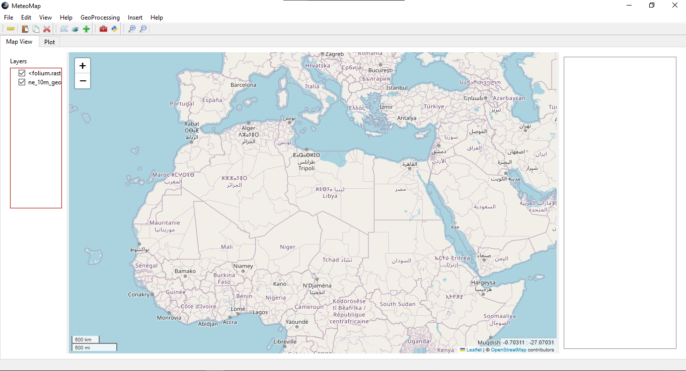
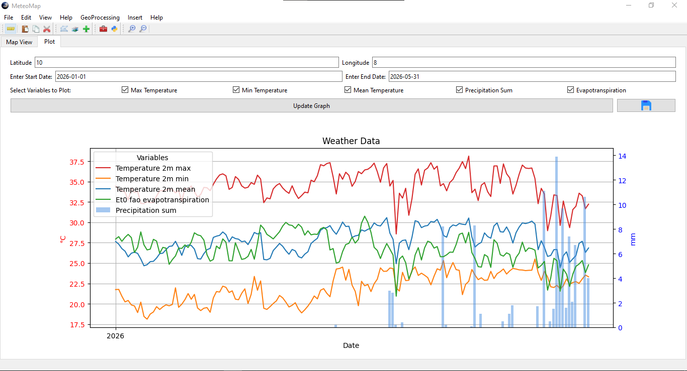
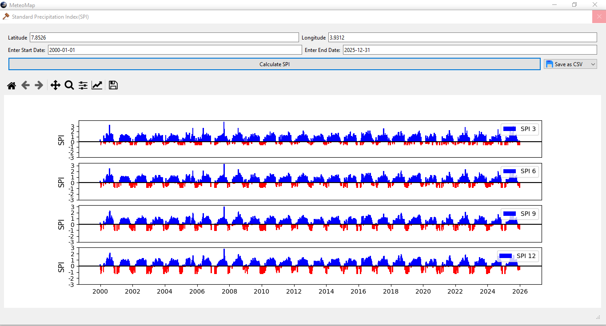
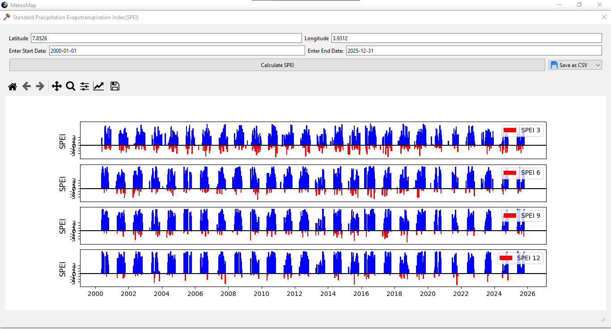

# MeteoMap

A desktop GIS application for visualising geospatial data and computing meteorological drought indices, built with PyQt6, Folium, and Open-Meteo ERA5 reanalysis data.


---
## Screenshots






---
## Features

### Map Viewer
- Interactive map powered by Folium rendered inside a `QWebEngineView`
- Support for multiple basemaps: OpenStreetMap, CartoDB, Stadia
- Mouse position display
- Layer toggle checkboxes
- Draw polygon tool

### Supported Layer Types
| Format | Class |
|---|---|
| GeoTIFF raster | `TIFFLayer`, `ColoredTIFFLayer` |
| Shapefile | `ShapefileLayer` |
| GeoJSON | `GeoJSONLayer` |
| Point markers | `CircleMarker` |
| NetCDF | `NetCDF` |

### Meteorological Analysis (Plot Tab)
- Fetches ERA5 reanalysis data from the Open-Meteo historical archive API
- Variables: temperature (max/min/mean), precipitation, evapotranspiration
- Dual-axis Matplotlib chart — temperature lines on primary axis, precipitation/ET bars on secondary

### Drought Indices (Tool Dialog)
- **SPI** (Standardized Precipitation Index) at 3, 6, 9, and 12-month timescales
  - Gamma distribution fitting via Thom's method of moments
  - Outputs a 4-panel colour-coded bar chart (blue = wet, red = dry)
- **SPEI** (Standardized Precipitation-Evapotranspiration Index) at 3, 6, 9, and 12-month timescales
  - Thornthwaite PET estimation from ERA5 temperature
  - Logistic distribution fitting on the water balance (P − PET)

### GIS Tools
**Conversion**
- NetCDF → raster / CSV / shapefile
- Shapefile ↔ GeoJSON
- Raster → point

**Geoprocessing**
- Buffer
- Clip (raster and vector)
- Union
- Intersect
- Extract by mask

**Spatial Analysis**
- IDW interpolation
- Spatial join

**Utilities**
- Built-in Python interpreter with stdout redirect
- Attribute table viewer

---

## Project Structure

```
MeteoMap/
│
├── main.py                     # Entry point — QSplashScreen → GISApp
│
├── app/
│   ├── gis_app.py              # GISApp (QMainWindow) — map tab, toolbars, menu
│   ├── graph_tab.py            # Plot tab — Open-Meteo fetch + Matplotlib canvas
│   └── tool_dialog.py          # ToolDialog — routes UI to tool functions
│
├── layers/
│   ├── raster.py               # TIFFLayer, ColoredTIFFLayer
│   ├── vector.py               # ShapefileLayer, GeoJSONLayer, CircleMarker
│   └── netcdf.py               # NetCDF layer stub
│
├── analysis/
│   ├── spi.py                  # spi() algorithm + Open-Meteo fetcher
│   ├── spei.py                 # spei() + thornthwaite_pet()
│   └── idw.py                  # IDW interpolation
│
├── tools/
│   ├── conversion.py           # Format conversion tools
│   └── geoprocessing.py        # Buffer, clip, union, intersect, extract_by_mask
│
├── widgets/
│   ├── table_model.py          # QAbstractTableModel for attribute tables
│   ├── basemap_dialog.py       # Basemap selector dialog
│   └── python_interpreter.py  # Embedded Python console
│
├── utils/
│   ├── paths.py                # resource_path() and get_app_temp_dir()
│   └── logger.py               # Rotating file logger setup
│
├── icons/                      # UI icons
├── logs/                       # Runtime log files (auto-created)
├── MeteoMap.spec               # PyInstaller build spec
└── requirements.txt
```

---

## Requirements

- Python 3.13
- Windows (tested), Linux (compatible)

Install all dependencies:

```bash
pip install -r requirements.txt
```

### Key dependencies

| Package | Purpose |
|---|---|
| PyQt6, PyQt6-WebEngine | Desktop UI and map rendering |
| folium | Interactive map generation |
| geopandas, shapely | Vector geospatial operations |
| rasterio, rioxarray | Raster data reading and writing |
| xarray, netCDF4 | NetCDF file support |
| numpy, pandas, scipy | Numerical computation and SPI/SPEI |
| matplotlib | Plotting charts and drought index output |
| openmeteo-requests | Open-Meteo API client |
| requests-cache | API response caching |

---

## Installation

```bash
# Clone the repository
git clone https://github.com/ThatPythonGuy96/MeteoGIS.git
cd MeteoGIS

# Create and activate a virtual environment
python -m venv map_env
map_env\Scripts\activate        # Windows
source map_env/bin/activate     # Linux/macOS

# Install dependencies
pip install -r requirements.txt

# Run the app
python MeteoMap.py
```

---

## Building a Windows Executable

MeteoMap uses PyInstaller with a custom `.spec` file to handle rasterio's dynamic imports and bundle the icons folder.

```bash
# Install the app and its packaging tools
python -m pip install -e ".[packaging]"

# Build
python -m PyInstaller --clean --noconfirm MeteoMap.spec
```

The packaged executable will be at `dist/MeteoMap.exe`.

### Automated Windows builds

The GitHub Actions workflow in `.github/workflows/windows.yml` builds the executable and Inno Setup installer on Windows. It runs for pushes and pull requests to `main` or `master`, version tags (`v*`), and manual dispatch. Download the `MeteoMap-Windows` artifact from the completed Actions run. For a versioned installer, push a tag such as `v1.3.0`; non-tag builds use a CI run-number version.

### Notes on packaging
- `rasterio`, `fiona`, `pyproj`, and `geopandas` are collected via `collect_all()` in the spec file because their Cython extension modules are not detectable by PyInstaller's static analysis
- All icon paths use `resource_path()` from `utils/paths.py` to resolve correctly inside the PyInstaller bundle
- Logs and writable app data are stored under `%LOCALAPPDATA%\MeteoMap` when packaged

---

## Usage

### Loading a layer
1. Use the **File** menu or toolbar to load a GeoTIFF, Shapefile, GeoJSON, or NetCDF file
2. The layer appears on the map and in the layer panel with a toggle checkbox

### Plotting meteorological data
1. Open the **Plot** tab
2. Enter a latitude, longitude, date range, and select variables
3. Click **Plot** — data is fetched from Open-Meteo ERA5 and displayed as a dual-axis chart

### Computing drought indices
1. Open **GeoProcessing → SPI** or **GeoProcessing → SPEI** from the menu
2. Enter coordinates and a date range (minimum 2 years recommended for statistical reliability)
3. Click **Calculate** — a 4-panel chart is displayed for 3, 6, 9, and 12-month timescales
4. Use the **Save** button to export the index values as CSV

### Geoprocessing tools
1. Open **GeoProcessing** from the menu or toolbar
2. Select a tool (Buffer, Clip, Union, Intersect, Extract by Mask)
3. Load input layers, set parameters, and click **Ok**
4. The result is automatically added to the map as a new layer

---

## Logging

Runtime logs are written to `logs/meteogis.log` (next to the script in dev, next to the exe in production). Logs rotate at 2 MB and keep the last 3 files.

```
2026-06-23 20:52:58 | INFO     | main.<module>:17      | MeteoGis starting up
2026-06-23 20:53:04 | DEBUG    | geoprocessing.buffer_data:89 | Buffer started
2026-06-23 20:53:04 | ERROR    | geoprocessing.buffer_data:102 | Buffer failed
Traceback (most recent call last):
  ...
```

---

## Known Limitations

- NetCDF layer display is not yet implemented (stub only)
- SPI/SPEI operate on daily rolling means; WMO-standard monthly aggregation is planned
- The application is single-threaded; heavy operations (large raster clips, long ERA5 fetches) will briefly freeze the UI

---

## Acknowledgements

- [Open-Meteo](https://open-meteo.com/) for free ERA5 reanalysis data
- [Folium](https://python-visualization.github.io/folium/) for the Leaflet.js map integration
- SPI algorithm based on WMO guidelines and Thom (1958) gamma parameter estimation

## Contributing

Contributions are welcome! Please read our
[Contributing Guidelines](CONTRIBUTING.md) before submitting a pull request.